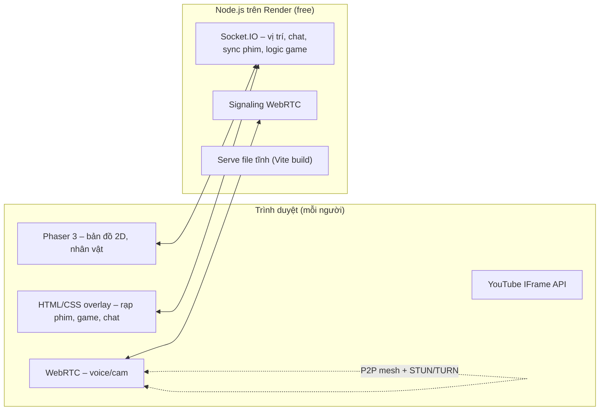

# 🎮 "Hội Quán" – Thế giới 2D riêng cho bạn & hội bạn

## 1. Tóm tắt yêu cầu
- Web game 2D pixel top-down (kiểu Gather.town), chỉ nhóm bạn dùng, không thương mại.
- **Tạo nhân vật** → vào **bản đồ chung**, đi lại bằng WASD/phím mũi tên, thấy nhau realtime.
- **Phòng chiếu phim**: dán link YouTube, mọi người xem **đồng bộ** play/pause/tua.
- **Phòng game**: 🎨 Vẽ & Đoán, ❓ Quiz nhiều người, ⭕ Cờ Caro 2 người.
- **Voice + video cam** (WebRTC), chat chữ + emoji bay.
- Deploy **host miễn phí**.

## 2. Giả định (cần bạn xác nhận)
| # | Giả định |
|---|---|
| A1 | Tối đa ~4–8 người online cùng lúc |
| A2 | Không cần tài khoản/mật khẩu cá nhân – nhân vật lưu ở `localStorage`. Cả web khóa bằng **1 mật khẩu chung** để người lạ không vào được |
| A3 | Không cần database – trạng thái phòng giữ trong RAM server (restart là reset, chấp nhận được) |
| A4 | Câu hỏi Quiz & từ khóa Vẽ-Đoán bằng **tiếng Việt**, mình soạn sẵn bộ đề (bạn có thể thêm sau) |
| A5 | Voice/video chỉ bật **trong cùng một phòng** (vào rạp → nghe người trong rạp), không bật ở bản đồ chung |

## 3. Kiến trúc & công nghệ



| Phần | Công nghệ | Lý do |
|---|---|---|
| Frontend | **Vite + Vanilla JS + Phaser 3** | Phaser là engine 2D chuẩn, có tilemap, va chạm, animation |
| UI overlay | HTML + Vanilla CSS (dark, glassmorphism, font Outfit/Pixelify Sans) | Dễ làm UI đẹp đè lên canvas |
| Bản đồ | **Tiled** map (JSON) + tileset pixel miễn phí (Kenney / LPC) | Chỉnh bản đồ trực quan |
| Realtime | **Socket.IO** | Đơn giản, tự reconnect |
| Voice/Cam | WebRTC mesh (mỗi người nối thẳng với nhau) + STUN Google + TURN miễn phí (Metered/OpenRelay) | Đủ tốt cho ≤6 người, không tốn server media |
| Hosting | **Render Web Service (free)** – 1 service chạy cả frontend + Socket.IO | Free, hỗ trợ WebSocket, không cần thẻ |

> [!WARNING]
> Render free sẽ **ngủ sau 15 phút** không ai truy cập; lần đầu mở lại mất ~30–50s để thức dậy. Với nhóm bạn thì chấp nhận được. (Railway/Fly.io không ngủ nhưng cần thẻ / có giới hạn credit.)

## 4. Cấu trúc thư mục dự kiến
```
web xem phim/
├── client/                 # Vite app
│   ├── index.html
│   ├── src/
│   │   ├── main.js
│   │   ├── styles/index.css         # design system
│   │   ├── scenes/                  # Phaser: Boot, CharacterCreate, World
│   │   ├── rooms/                   # cinema.js, drawGuess.js, quiz.js, caro.js
│   │   ├── net/socket.js, net/rtc.js
│   │   └── ui/                      # chat, emoji, video grid, modal
│   └── public/assets/               # tileset, sprite, map.json, âm thanh
├── server/
│   ├── index.js                     # Express + Socket.IO
│   ├── world.js                     # người chơi, vị trí
│   ├── rooms/cinema.js, drawGuess.js, quiz.js, caro.js
│   └── data/quiz-vi.json, words-vi.json
└── package.json
```

## 5. Chi tiết tính năng

### 5.1 Tạo nhân vật
- Nhập tên, chọn **thân/tóc/áo/quần + màu** (sprite xếp lớp kiểu LPC), xem trước nhân vật xoay 4 hướng.
- Lưu `localStorage` → lần sau vào thẳng.

### 5.2 Bản đồ chung (Lobby)
- Một khu phố nhỏ: **Rạp phim 🎬**, **Phòng Vẽ 🎨**, **Phòng Quiz ❓**, **Quán Caro ⭕**, có cây, ghế, đèn.
- Đi tới cửa → hiện "Nhấn **E** để vào".
- Tên + bong bóng chat trên đầu nhân vật; emoji bay (phím 1–6).
- Server broadcast vị trí ~15 lần/giây, client nội suy cho mượt.

### 5.3 🎬 Rạp phim
- Màn hình lớn ở giữa, ghế ngồi có nhân vật của mọi người.
- Dán link YouTube → thêm vào **hàng chờ (playlist)**.
- Sync: server giữ `{videoId, isPlaying, position, updatedAt}`; ai play/pause/tua → broadcast; người mới vào tự nhảy đúng giây; tự sửa lệch > 1.5s.
- Lưới video cam nhỏ ở góc + nút mic/cam/rời phòng.

### 5.4 🎨 Vẽ & Đoán
- Lượt luân phiên, người vẽ chọn 1 trong 3 từ, 80s/lượt.
- Canvas đồng bộ nét vẽ (màu, cỡ bút, tẩy, xóa hết, undo).
- Người khác gõ đoán trong chat; đoán đúng sớm → nhiều điểm; gợi ý chữ cái hiện dần.

### 5.5 ❓ Quiz
- Chủ phòng bấm bắt đầu, 10 câu, 15s/câu, 4 đáp án.
- Điểm theo tốc độ, bảng xếp hạng sau mỗi câu + màn hình podium cuối.

### 5.6 ⭕ Cờ Caro
- Bàn 15×15, luật 5 ô thắng; người thứ 3+ vào xem.
- Đếm giờ mỗi nước, nút đầu hàng / chơi lại / đổi bên.

### 5.7 Voice/Video
- Vào phòng nào → tự kết nối WebRTC với người cùng phòng (mặc định **tắt mic/cam**, bấm để bật).
- Signaling qua Socket.IO.

## 6. Lộ trình triển khai
| Giai đoạn | Nội dung | Kết quả kiểm chứng |
|---|---|---|
| **1. Nền tảng** | Khởi tạo Vite + server Express/Socket.IO, design system CSS, màn hình mật khẩu | Chạy `npm run dev`, 2 tab cùng kết nối |
| **2. Nhân vật & bản đồ** | Tạo nhân vật, bản đồ Tiled, di chuyển, va chạm, thấy nhau, chat | 2 tab thấy nhau đi lại mượt |
| **3. Rạp phim** | Phòng rạp, YouTube sync, playlist | 2 tab xem cùng, pause/tua đồng bộ |
| **4. Voice/Video** | WebRTC mesh + UI lưới cam | 2 trình duyệt nghe/thấy nhau |
| **5. Caro** | Logic + UI | Chơi hết ván giữa 2 tab |
| **6. Vẽ & Đoán** | Canvas sync, lượt, điểm | 3 tab chơi trọn 1 vòng |
| **7. Quiz** | Bộ đề, timer, xếp hạng | 3 tab chơi trọn 10 câu |
| **8. Polish & Deploy** | Âm thanh, animation, responsive, deploy Render | Mở link Render từ 2 máy khác mạng |

Kiểm thử: dùng browser mở nhiều tab giả lập nhiều người ở mỗi giai đoạn; logic game (thắng Caro, chấm điểm Quiz) có unit test nhỏ.

## 7. Câu hỏi còn mở
1. Tên web/chủ đề bản đồ: thành phố hiện đại, làng quê Việt Nam, hay vũ trụ/neon?
2. Có muốn **mật khẩu chung** (A2) không, hay ai có link là vào được?
3. Bạn đã có tài khoản **GitHub** chưa? (Render deploy từ GitHub repo.)

## 8. Nhật ký quyết định
| Quyết định | Phương án khác | Lý do chọn |
|---|---|---|
| Bản đồ 2D pixel + Phaser 3 | 3D Three.js, menu thường | Bạn chọn; 2D nhẹ, dễ làm đẹp |
| Nguồn phim: YouTube | mp4/m3u8, upload, share màn hình | Bạn chọn; không tốn băng thông server |
| Game: Vẽ-Đoán, Quiz, Caro | UNO, đua gõ phím, bầu cua | Bạn chọn |
| Host: Render free | Railway, Fly.io, tunnel | Bạn chọn host free; Render không cần thẻ |
| Voice+Cam: WebRTC mesh | SFU (LiveKit) | Ít người nên mesh đủ, không tốn server |
| Không DB, localStorage | Postgres/Mongo | YAGNI – nhóm nhỏ, không cần lưu lâu dài |
